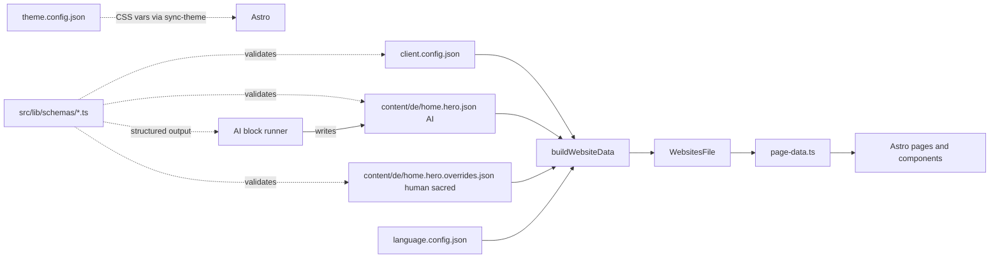

# Restructure Website Data

## Goals (recap)

- Move misplaced fields into the right bucket; drop the niche-template idea.
- Eliminate the duplicated schema blocks, duplicated section-visibility, and the brittle empty-`pages[]` placeholders.
- Switch to **objects keyed by id** wherever the set of items is stable.
- Define one Zod schema per AI-generated **block**, in a central, repo-portable location.
- Rewrite the AI generation pipeline to call one block at a time with structured output. No backward compat with the old scripts.
- Keep the renderer's contract (`WebsitesFile` / `ResolvedPageData`) unchanged so Astro pages, components, and the editor's `data-hero-factory-src-path` keep working with no edits.

## Three layers of content

- **Layer 1 — `client.config.json`**: human-owned, almost never changes. Identity, business, organization, link IDs, link hrefs, sections list, item taxonomy. Language list stays in existing [language.config.json](src/data/nicezeit/language.config.json). Design tokens stay only in [theme.config.json](src/data/nicezeit/theme.config.json) (see Per-client theming below); `client.config` does not duplicate colors/fonts.
- **Layer 2 — `content/<lang>/<block>.json`**: AI-owned, regeneratable any time. Marketing copy, FAQs, metadata strings, niche-flavoured headings. Each block carries `_meta`: `{ model, promptHash, generatedAt }`.
- **Layer 3 — `content/<lang>/<block>.overrides.json`**: human-owned, **sacred** — never written by AI. Editors freeze any leaves they want. Implicit lock: presence of a key wins.

**Merge order per leaf:** schema defaults → ai → overrides → `client.config` (where applicable). The compat layer then assembles `WebsitesFile` as today.

Overrides keep regenerations idempotent, keep PR diffs small, and avoid editors fighting the AI runner.

## Architecture



## 1. New file layout under `src/data/nicezeit/`

Delete:

- [src/data/nicezeit/website-static.json](src/data/nicezeit/website-static.json)
- [src/data/nicezeit/website-content.json](src/data/nicezeit/website-content.json)

Create:

```
src/data/nicezeit/
├── client.config.json
└── content/
    ├── de/
    │   ├── header.json
    │   ├── header.overrides.json
    │   ├── footer.json
    │   ├── footer.overrides.json
    │   ├── itemPage.json
    │   ├── itemPage.overrides.json
    │   ├── home.metadata.json
    │   ├── home.metadata.overrides.json
    │   ├── home.hero.json
    │   ├── home.hero.overrides.json
    │   ├── home.ranking.json
    │   ├── home.ranking.overrides.json
    │   ├── home.map.json
    │   ├── home.map.overrides.json
    │   ├── home.trust.json
    │   ├── home.trust.overrides.json
    │   ├── home.faq.json
    │   ├── home.faq.overrides.json
    │   ├── home.disclaimer.json
    │   ├── home.disclaimer.overrides.json
    │   ├── ratgeber.metadata.json
    │   ├── ratgeber.hero.json
    │   ├── ratgeber.articles.json
    │   ├── pruefkriterien.metadata.json
    │   ├── pruefkriterien.hero.json
    │   ├── pruefkriterien.criteria.json
    │   ├── pruefkriterien.cta.json
    │   ├── pruefkriterien.disclaimer.json
    │   ├── kontakt.metadata.json
    │   ├── kontakt.hero.json
    │   ├── kontakt.form.json
    │   ├── kontakt.success.json
    │   ├── kontakt.toast.json
    │   ├── kontakt.email.json
    │   └── ... (paired overrides for each block)
    └── en/                       # mirrors de/, populated via translate-data.ts
        └── ...
```

Commit `*.overrides.json` even when empty (`{}`) so editors can find them and PR diffs stay clear.

### Bucket rules

`client.config.json` owns:

- Per-client identity: `deployDomain`, `clientDomain`, `googleTagId`, `addressLocality`, `addressCountry`.
- Modes: `datenschutzResponsibleMode`, `impressumResponsibleMode`, `websiteCtaFallback`.
- `business` (legalName, vertreter, ustId, address, phone, email, openingHours, social, contactPerson, googlePlacesId).
- `organization` (name, url, logo, areaServed, address) — single source for Schema.org.
- Item taxonomy: `itemLabel`, `itemLabelPlural`, `itemDetailPath`, `routePrefix`, `ratgeberLabel`.
- Structural fields (hrefs, types, ids) for `header.links`, `footer.links`, `pruefkriterien.criteria`.
- `header.logoUrl`, `header.aria*`.
- `impressumBacklink`.
- `sections: SectionId[]` — single ordered, visible-by-presence list (replaces both `sectionIds` and `sectionVisibility`).

Languages: **not** duplicated here — [language.config.json](src/data/nicezeit/language.config.json) remains the source of truth (`defaultLanguage`, `supportedLanguages`).

`content/<lang>/<block>.json` owns:

- All marketing/SEO copy: hero text, ranking lead/note, trust narrative, FAQ Q&As, criteria titles+descriptions, page metadata title/description/keywords, disclaimers.
- Niche-flavoured strings (e.g. "Eisdiele vorschlagen") — these go in `header.json`.
- `cookie.*`, `notFound.*`, ARIA labels and form labels stay in `client.config.json` because with one client per niche they are written once and not regenerated.

## 2. Object-keyed structures (no more parallel arrays)

`client.config.json` (excerpt):

```json
{
  "header": {
    "logoUrl": "/images/logo.DRDywk_Z_ZIJ5cD.webp",
    "ariaLabelNavigation": "Navigation",
    "ariaMenuOpen": "Menü öffnen",
    "ariaMenuClose": "Menü schließen",
    "linkOrder": ["top10", "ratgeber", "pruefkriterien", "kontakt"],
    "links": {
      "top10": { "href": "/#ranking", "type": "link" },
      "ratgeber": { "href": "/ratgeber", "type": "link" },
      "pruefkriterien": { "href": "/pruefkriterien", "type": "link" },
      "kontakt": { "href": "/kontakt", "type": "link" }
    }
  },
  "pruefkriterien": {
    "criteriaOrder": ["1", "2", "3", "4", "5", "6", "7", "8", "9"],
    "criteria": {
      "1": {
        "number": "1",
        "category": "Datenbasiert · Kundenfeedback",
        "gradient": "from-amber-300 via-orange-400 to-rose-400"
      },
      "2": {
        "number": "2",
        "category": "Sortiment · Auswahl",
        "gradient": "from-emerald-300 via-teal-400 to-cyan-400"
      }
    }
  }
}
```

`content/de/header.json`:

```json
{
  "logoAlt": "Top Eis Hannover",
  "links": {
    "top10": { "label": "Top 10" },
    "ratgeber": { "label": "Ratgeber" },
    "pruefkriterien": { "label": "Prüfkriterien" },
    "kontakt": { "label": "Eisdiele vorschlagen" }
  }
}
```

`content/de/pruefkriterien.criteria.json`:

```json
{
  "criteria": {
    "1": { "title": "Google-Bewertungen", "description": "..." },
    "2": { "title": "Angebotsvielfalt", "description": "..." }
  }
}
```

`buildWebsiteData` materialises the legacy array shape (`HeaderNavLink[]`, `criteria[]`) by walking `linkOrder`/`criteriaOrder` and merging `config.links[id]` with `content.links[id]` per item. The renderer continues to receive arrays.

## 3. Pages: object-keyed, no empty placeholders

Internally the loader assembles `pages` as `Record<PageName, PageData>`. The compat layer flattens to the existing `pages: PageData[]` (in section-order) just before handing off to [src/lib/page-data.ts](src/lib/page-data.ts), so `getPage(websiteId, 'home')` keeps matching by `name` exactly as it does today.

## 4. Sections: single source

Drop both top-level `sectionIds[]` and per-website `sectionVisibility{}` from source files. Replace with `client.config.sections: SectionId[]`. The compat layer translates this into the legacy `sectionIds[]` so [src/lib/page-data.ts](src/lib/page-data.ts) `defaultSectionConfigs` and `getResolvedPageData`'s visibility resolution stay untouched.

## Multi-language layout

Pinned to existing infrastructure:

- Source of truth: `src/data/<clientId>/language.config.json` (example: [language.config.json](src/data/nicezeit/language.config.json)) — `defaultLanguage`, `supportedLanguages`. Do not introduce a second language config.
- Files: one folder per language under `content/<lang>/`. Default language folder is required; others optional.
- Loader: `loadWebsiteSources(lang)` reads `content/<lang>/` first, falls back to `content/<defaultLanguage>/` per missing block (preserve per-language fallback in [src/lib/page-data.ts](src/lib/page-data.ts)).
- Routing: unchanged — pages under `[lang]/`; build emits routes per supported language as today.
- AI: `pnpm generate-website` defaults to iterating `language.config.supportedLanguages`. `--language=en` limits to one language. `--blocks=home.hero` narrows scope.
- Translation: rewrite [scripts/translation/translate-data.ts](scripts/translation/translate-data.ts) to operate per block file (`content/<defaultLanguage>/<block>.json` → `content/<targetLang>/<block>.json`) with skip-keys from language.config. **Do not** machine-translate `*.overrides.json` — they stay language-specific human content. [scripts/translation/add-language.ts](scripts/translation/add-language.ts) creates an empty `content/<lang>/` mirror and updates `supportedLanguages`.
- Compat: slot each language's resolved tree into the existing `WebsitesFile` / per-language map shape the app already expects.

## 5. Schema.org dedup + placeholder substitution

Stop storing the Organization + WebSite blocks 5 times. The build layer:

- Auto-derives a base `Organization` and `WebSite` JSON-LD object from `client.config.organization` + `client.config.business`.
- Appends them to every `page.metadata.schema[]` at build time.
- `content/<page>.metadata.json#schema` only contains **page-specific** schemas (Article, BreadcrumbList, FAQPage, etc.) — no Organization/WebSite duplication.

Token substitution: a single helper resolves `{year}`, `{brandName}`, `{locationName}`, `{itemLabel}`, `{itemLabelPlural}` against `client.config` + current date. Run it during `buildWebsiteData` so the renderer never sees raw placeholders. Removes hardcoded "2026" from JSON.

## Per-client theming (preserved)

- Theming stays in `src/data/<clientId>/theme.config.json` (example: [theme.config.json](src/data/nicezeit/theme.config.json)) and [scripts/dev/sync-theme-to-globals.mjs](scripts/dev/sync-theme-to-globals.mjs) → CSS variables in `src/styles/globals.css`.
- `client.config.json` must **not** duplicate colors, fonts, or `customCss`.
- `buildWebsiteData` does not drive theming. Components keep using `var(--primary)`, `var(--accent)`, etc.
- Rationale: single source of truth for tokens; existing WCAG-derived foreground logic stays intact.

## 6. Centralised schemas: `src/lib/schemas/`

```
src/lib/schemas/
├── primitives.ts            # PageMetadata, OpenGraph, Twitter, SchemaEntry, SectionId
├── config.ts                # ClientConfigSchema (Zod) — describes client.config.json
├── blocks/
│   ├── header.ts            # HeaderContentSchema
│   ├── footer.ts
│   ├── itemPage.ts
│   ├── hero.ts              # generic hero schema; pages reference it
│   ├── ranking.ts
│   ├── map.ts
│   ├── trust.ts
│   ├── faq.ts
│   ├── disclaimer.ts
│   ├── criteria.ts
│   ├── metadata.ts          # PageMetadataContentSchema
│   ├── form.ts
│   └── ...
├── registry.ts              # BLOCKS: { name, file, schema, scope, prompt } registry
└── index.ts                 # public API + inferred TS types
```

`registry.ts` is the heart: it lists every AI-generated block and the file it writes to. Both the loader (validation on read) and the AI runner (validation on write) iterate this registry — single source of truth.

```ts
export const BLOCKS = [
  {
    name: 'header',
    file: 'header.json',
    schema: HeaderContentSchema,
    scope: 'site',
  },
  {
    name: 'home.hero',
    file: 'home.hero.json',
    schema: HeroContentSchema,
    scope: 'page',
    page: 'home',
  },
  {
    name: 'home.trust',
    file: 'home.trust.json',
    schema: TrustContentSchema,
    scope: 'page',
    page: 'home',
  },
  {
    name: 'home.faq',
    file: 'home.faq.json',
    schema: FaqContentSchema,
    scope: 'page',
    page: 'home',
  },
  {
    name: 'pruefkriterien.criteria',
    file: 'pruefkriterien.criteria.json',
    schema: CriteriaContentSchema,
    scope: 'page',
    page: 'pruefkriterien',
  },
  // ...
] as const satisfies readonly BlockDef[];
```

TypeScript types in [src/types/page.ts](src/types/page.ts) are rewritten to be `z.infer<>` of the schemas, exported via `index.ts`. `WebsitesFile` and `ResolvedPageData` are kept (as the renderer contract) and produced by the compat layer.

**Image fields in schemas:** `{ src: string; alt: string; width: number; height: number }` only — assets are pre-optimized in repo; AI fills `alt` only, never invents paths.

## 7. Loader changes

[src/lib/page-data.ts](src/lib/page-data.ts):

- Replace the `import.meta.glob` patterns with:
  - `'/src/data/current/client.config.json'`
  - `'/src/data/current/content/*/*.json'` (include overrides files; merge in build layer)
- New helper `loadWebsiteSources(lang)` reads config + every content block + overrides, validates each via the registry, then calls `buildWebsiteData(config, contentByBlock, lang)`.
- `buildWebsiteData` lives in a new file [src/lib/build-website-data.ts](src/lib/build-website-data.ts) and produces a `WebsitesFile` whose shape is identical to today's merged output (one entry in `websites[]`, `pages[]` ordered, schemas materialised, placeholders resolved).
- Delete [src/lib/merge-website-data.ts](src/lib/merge-website-data.ts) (replaced by `build-website-data.ts`).

`createSrcPath` for the editor returns paths into the new files (e.g. `data/current/content/de/home.hero.json#headline` or overrides when applicable). A small mapping table in `build-website-data.ts` records which renderer fragment came from which file/key, so the editor can patch the right source.

## Legal pages as templates (no AI)

Compliance-sensitive; do not LLM-generate.

- Source: `src/templates/legal/impressum.<lang>.md` and `src/templates/legal/datenschutz.<lang>.md` — hand-maintained per language.
- Substitution: `{brandName}`, `{legalName}`, `{vertreter}`, `{ustId}`, `{address.street}`, `{address.postalCode}`, `{address.city}`, `{phone}`, `{email}`, `{year}`, plus `{datenschutzResponsibleMode}` / `{impressumResponsibleMode}` for branching.
- Build: `renderLegal(template, clientConfig, lang)` in the build layer; [src/pages/[lang]/impressum.astro](src/pages/[lang]/impressum.astro) and [src/pages/[lang]/datenschutz.astro](src/pages/[lang]/datenschutz.astro) consume the output.
- AI runner skips legal; legal blocks are **not** in `BLOCKS`.
- Migration: one-time extract of legal copy from old JSON into templates.

## 8. AI generation rewrite (full replace, no compat)

Delete:

- [scripts/06-generate-website.ts](scripts/06-generate-website.ts)
- [scripts/08-refine-website-data.ts](scripts/08-refine-website-data.ts)
- [scripts/improve-copy.ts](scripts/improve-copy.ts)
- [scripts/lib/read-merged-websites.mjs](scripts/lib/read-merged-websites.mjs) (and the conversion-kit copy can be left untouched as documented sandbox).

Create:

- [scripts/lib/generate-block.ts](scripts/lib/generate-block.ts) — `generateBlock(blockName, { config, language, model })`:
  1. Looks up `BLOCKS[blockName]`.
  2. Builds a context payload from `client.config` (brand, location, niche, item label, link IDs, criterion IDs).
  3. Calls the LLM with **structured output** constrained by `block.schema` (OpenAI `response_format: { type: 'json_schema' }` via the existing `openai` SDK against OpenRouter).
  4. **Skip rule:** before writing, read paired `content/<lang>/<block>.overrides.json` and omit any leaf paths already present there (idempotent regens, protects manual edits).
  5. Append `"_meta": { "model": "<id>", "promptHash": "<sha256 of prompt+schema>", "generatedAt": "<iso>" }` to each generated block.
  6. Parses, validates with Zod, writes to `src/data/<client>/content/<lang>/<file>`.
- [scripts/generate-website.ts](scripts/generate-website.ts) — orchestrator:
  - Iterates `BLOCKS`; default language loop = `language.config.supportedLanguages`.
  - Optional `--blocks home.hero,home.trust` for partial regen.
  - Optional `--language en` for a single language.
  - Prompt always includes target `lang`. Non-default languages: generate fresh or translate-from-default per-block (configurable on `BLOCKS`).
  - Concurrency: `Promise.all` with a small cap (e.g. `p-limit` 4) for predictable OpenRouter cost.
- [scripts/regenerate-block.ts](scripts/regenerate-block.ts) — thin wrapper: `pnpm regenerate-block home.faq`.

Existing scripts to update (not delete):

- [scripts/use-client.ts](scripts/use-client.ts) — symlink/copy `client.config.json` and the entire `content/` tree into `src/data/current/`.
- [scripts/clone-website.ts](scripts/clone-website.ts) — clone the new layout.
- [scripts/translation/translate-data.ts](scripts/translation/translate-data.ts) — per-block files into `content/<targetLang>/`.
- [scripts/onboard-client.ts](scripts/onboard-client.ts) and [scripts/01-create-client.ts](scripts/01-create-client.ts) — emit the new layout for new clients.

`package.json` scripts:

- Add `"generate-website": "tsx scripts/generate-website.ts"`.
- Add `"regenerate-block": "tsx scripts/regenerate-block.ts"`.
- Update `"translate-data"` to use the new per-block translator.
- Add `"build:client"` / `"build:all"` when CI script lands (see below).

## CI: matrix build per client

- Add [scripts/build-client.ts](scripts/build-client.ts): `CLIENT=<id>`, optional `LANG=<code>`, point `src/data/current` at `src/data/<client>/`, run `astro build`; optional output under `dist/clients/<client>/`. Fail loudly on error.
- Add `pnpm build:client` and `pnpm build:all` (iterate `src/data/*/` excluding `_template`) to [package.json](package.json).
- Add `.github/workflows/build-deploy.yml` with `discover` (JSON matrix from `src/data/*/`) and `build` (`matrix.client`, run `pnpm build:client`, then deploy via existing path — [vercel.json](vercel.json) or [scripts/dev/build-deploy-cf.mjs](scripts/dev/build-deploy-cf.mjs)).
- Optional: path filters so only changed `src/data/<client>/` rebuilds in PRs.
- Out of scope here: picking Vercel vs Cloudflare, per-client secrets, custom domains — assume one deploy target per client exists.

## 9. Field-level migration map (high signal items)

Source → destination for the most-asked-about fields:

- `cookie.*` → `client.config.cookie`
- `notFound.*` → `client.config.notFound`
- `header.logoAlt` → `content/<lang>/header.json#logoAlt`
- `header.aria*` → `client.config.header`
- `header.links[].label`→ `content/<lang>/header.json#links.<id>.label`
- `header.links[].href` → `client.config.header.links.<id>.href`
- `footer.links` → split same as header
- `itemPage.specialtyLabel`, `itemPage.feedbackLabel`, etc. → `client.config.itemPage` (templates) + `content/<lang>/itemPage.json` (any niche-flavoured strings)
- `itemPage.feedbackData[]` → `content/<lang>/itemPage.json#feedbackData[]` (AI-owned array, no IDs needed)
- `pruefkriterien.criteria[*].number/category/gradient` → `client.config.pruefkriterien.criteria.<id>`
- `pruefkriterien.criteria[*].title/description` → `content/<lang>/pruefkriterien.criteria.json#criteria.<id>`
- All `metadata.schema` Organization/WebSite blocks → deleted; auto-derived from `client.config`.
- `pages[*]` (8 empty placeholders) → gone; pages are an internal `Record<name, PageData>` assembled by the build layer.
- `sectionIds[]` + `sectionVisibility{}` → `client.config.sections: SectionId[]`.
- All hardcoded "2026" → `{year}` placeholders.
- Impressum/Datenschutz body copy → `src/templates/legal/*.md` + placeholders (not JSON marketing blocks).

## 10. Validation + safety

- Every read goes through Zod (`schema.parse` in `buildWebsiteData`); a single bad block fails the dev server with a precise path so the issue is obvious.
- Build-time assertion: for every object-keyed map, `Object.keys(content.X) ⊆ Object.keys(config.X)` (catches AI hallucinated IDs).
- `pnpm type-check` should pass with the new schema-derived types.

## Images: plain ``

All images are pre-optimized (WebP/AVIF, correct dimensions) before commit under `src/data/<client>/` or [public/](public). Components use plain `` with explicit `width`, `height`, and descriptive `alt`. No Astro `<Image>`, no `next/image`. AI never invents image paths — only `alt` text where schemas allow.

## 11. Out of scope (explicitly)

- Astro pages and components ([src/pages/\*_/_.astro](src/pages), [src/components/\*\*](src/components), [src/layouts/PageContent.astro](src/layouts/PageContent.astro)) — unchanged where possible; prefer exposing impressum/datenschutz body via the same `page-data` / `WebsitesFile` surfaces so templates stay a build-layer concern.
- [src/data/current/items.json](src/data/current/items.json) and `faqs.json` — separate first-class files, untouched.
- The `conversion-kit/` sandbox folder — untouched (its `read-merged-websites.mjs` copy and `websites.json` are documentation/migration assets, not consumed by the live app).
- Adding a workspace package or extracting schemas into a shared monorepo — deliberately deferred; portability is achieved by `src/lib/schemas/` being self-contained and copy-pasteable.
- Moving client data to a top-level `clients/<id>/` folder — keep `src/data/<client>/` per existing convention.
- Choosing or configuring multi-region deployment hosts — CI matrix is documented; host setup is a separate task.
