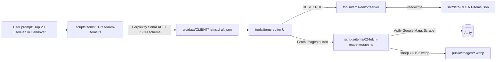

## Architecture



The three pieces are decoupled so each can be run/replaced independently.

---

## 1. Research script: `scripts/items/01-research-items.ts`

- New folder `scripts/items/` (sibling to existing numbered scripts).
- Inputs (CLI flags + interactive `enquirer` prompts, matching style of [scripts/05-extract-client-data.mjs](scripts/05-extract-client-data.mjs)):
  - `--client=<id>` (e.g. `nicezeit`) \u2013 target folder under `src/data/`
  - `--prompt="Top 20 Eisdielen in Hannover, Deutschland"` \u2013 user research prompt
  - `--count=20`, `--lang=de`, `--out=items.draft.json`
- Calls Perplexity Sonar (`https://api.perplexity.ai/chat/completions`, model `sonar-pro` or `sonar-reasoning-pro`) with:
  - System prompt describing the schema below and ranking criteria (Google reviews, local relevance, diversity, etc.).
  - User prompt = the user's research request.
  - `response_format: { type: 'json_schema', json_schema: { schema: ItemsSchema } }` so the model returns structured JSON directly.
  - Honors user rule: German output uses informal "Du".
- Item schema (Zod, mirrors current [src/data/nicezeit/items.json](src/data/nicezeit/items.json)):
  - Required: `rank`, `name`, `address`, `slug`, `specialty`, `description`, `tags[]`, `rankingReason`, `rating{avg,count}`
  - Optional: `priceRange`, `openingHours`, `suitableFor[]`, `phone`, `email`, `website`, `lat`, `lng`, `mapsUrl`, `badge`, `usps[]`, `brandStory`, `isClient`, `isFeatured`, `featuredBrandName`
  - `image` left empty \u2013 filled by image script.
- Writes `src/data/<client>/items.draft.json` plus a sidecar `items.draft.meta.json` with the Perplexity citations array (so we can audit sources later).
- Add npm script: `"items:research": "tsx scripts/items/01-research-items.ts"`.
- Env: `PERPLEXITY_API_KEY` in `.env` (document in script header).

Notes on engine choice: Perplexity Sonar is the right fit because it does the web search itself, returns citations, and supports JSON schema output \u2013 we don't need an agent loop or Firecrawl for the research step. Firecrawl stays available if we later want deep-dive scraping of an individual candidate's website (left as an optional `--enrich` flag, not v1).

---

## 2. Image fetcher: `scripts/items/02-fetch-maps-images.ts`

- Reads `items.json` (or `items.draft.json` via `--source=draft`).
- For each item without an `image`, calls the Apify [Google Maps Scraper](https://apify.com/compass/crawler-google-places) actor via `apify-client`:
  - Query = `${item.name} ${item.address}` (or `item.lat,lng` when present).
  - `maxImages: 5`, `maxItems: 1`.
  - From the result extracts `placeId` (\u2192 fills `mapsUrl`), `location.lat/lng`, `phone`, `website`, `openingHours`, `totalScore`/`reviewsCount` (\u2192 fills missing `rating`), and `imageUrls[0]`.
- Downloads the top image, runs through `sharp` (already a dep) \u2192 1600px max width, webp q80, writes to `public/images/<slug>.webp`.
- Updates the item in-place: `image: "<slug>.webp"` (matches current convention seen in [items.json](src/data/nicezeit/items.json) line 10).
- Idempotent: skips items that already have an image and a maps URL unless `--force`.
- Add deps: `apify-client`. Env: `APIFY_TOKEN`.
- npm script: `"items:images": "tsx scripts/items/02-fetch-maps-images.ts"`.

---

## 3. Portable editor module: `tools/items-editor/`

Standalone module with its own `package.json` so the entire folder can be copied into another repo later. Structure:

```
tools/items-editor/
  package.json          # vite + react + express; "dev" runs both
  README.md             # how to port to another repo
  vite.config.ts        # proxies /api/* to the local server
  server/
    index.ts            # tiny Express server (port 5174)
    items.ts            # GET/PUT/POST/DELETE /api/items, GET /api/clients
    config.ts           # resolves DATA_ROOT (default ../../src/data) via env
  src/
    main.tsx, App.tsx
    components/
      ItemsTable.tsx    # drag-to-reorder, rank auto-recalc, search
      ItemEditor.tsx    # form for one item (react-hook-form + zod)
      ImagePicker.tsx   # upload OR 'Fetch from Google Maps' button \u2192 calls /api/items/:slug/fetch-image
      ClientPicker.tsx
    lib/
      schema.ts         # SAME Zod schema as research script (shared via relative import or copied; documented in README)
      api.ts
```

Endpoints:

- `GET  /api/clients` \u2192 list of folders in `DATA_ROOT` that contain `items.json`
- `GET  /api/clients/:client/items`
- `PUT  /api/clients/:client/items` \u2192 save full array (atomic write w/ `.tmp` rename)
- `POST /api/clients/:client/items` \u2192 add one
- `DELETE /api/clients/:client/items/:slug`
- `POST /api/clients/:client/items/:slug/fetch-image` \u2192 shells out to the script in step 2 with `--slug` filter
- `POST /api/clients/:client/items/import-draft` \u2192 promotes `items.draft.json` to `items.json`

UI features (kept minimal but complete):

- Sortable list of 20 items (rank reorder), inline edit, add/remove, validation errors inline.
- Side-by-side draft vs. published diff when a draft exists.
- "Open in Google Maps" link, image preview, copy-to-clipboard for slug.
- Read-only fields when `isClient: true` are clearly marked but still editable.

Portability:

- Module reads the data root from `ITEMS_EDITOR_DATA_ROOT` env (defaults to `../../src/data` relative to the module), so dropping the folder into another repo only requires setting that env var.
- Own lockfile (pnpm), own `pnpm dev`. Top-level `package.json` gets a convenience script `"items:editor": "pnpm --dir tools/items-editor dev"`.

---

## 4. Wiring & docs

- New `scripts/items/README.md`: end-to-end workflow (research \u2192 review in editor \u2192 fetch images \u2192 publish).
- Add to root [package.json](package.json) scripts:
  - `items:research`, `items:images`, `items:editor`
- `.env.example` (or note in README) gains `PERPLEXITY_API_KEY` and `APIFY_TOKEN`.
- No changes to existing build pipeline; `items.json` shape is preserved exactly so the existing Astro pages keep rendering unchanged.

---

## Out of scope (v1)

- Authentication on the editor (it's a local dev tool; binds to `127.0.0.1`).
- Multi-language item generation (the existing translation scripts under `scripts/translation/` already cover this once items exist).
- Automatic re-ranking when items are reordered beyond renumbering `rank` 1..N.
