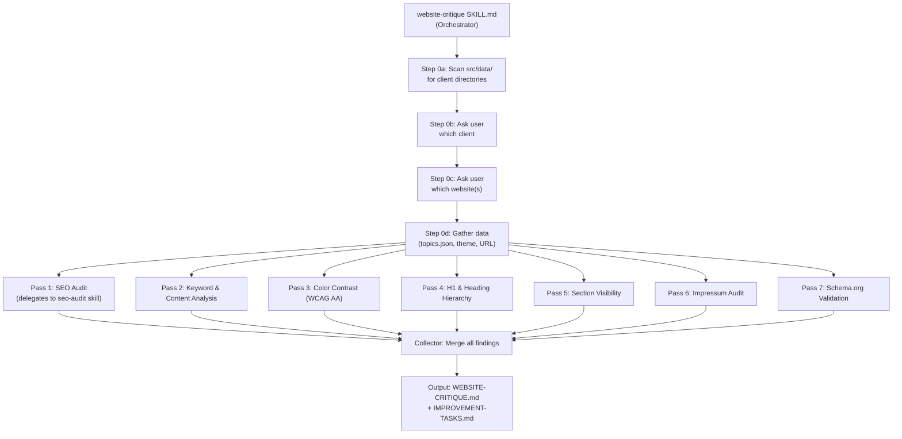

# Website Critique & Consultant Service

## Architecture

The service is a **Claude Code skill** at `~/.claude/skills/website-critique/` with a main `SKILL.md` orchestrator and several reference files for each analysis pass. It works for **any repository** -- not just this template.location project -- by detecting available data files and falling back to scraping when needed.



Each pass is designed to run as a **separate Claude Code session** (subagent) for parallelism and context efficiency. The orchestrator coordinates them.

---

## File Structure

```
~/.claude/skills/website-critique/
  SKILL.md                          # Main orchestrator
  references/
    pass-keyword-content.md         # Pass 2 instructions
    pass-color-contrast.md          # Pass 3 instructions
    pass-h1-headings.md             # Pass 4 instructions
    pass-section-visibility.md      # Pass 5 instructions
    pass-impressum-audit.md         # Pass 6 instructions
    pass-schema-validation.md       # Pass 7 instructions
    task-output-format.md           # Standard task output schema
```

---

## Phase 0: Client & Site Selection + Data Gathering

This is a **template repository** where `src/data/` contains multiple client directories, each with its own `websites.json` holding one or more website entries. The orchestrator must disambiguate before any analysis begins.

### Step 0a: Discover clients

1. Scan `src/data/*/websites.json` for all client directories
2. Exclude `_template/` (scaffold) and `current/` (symlink directory pointing to the active client)
3. For each client directory, read `clientName` and `clientDomain` from `websites.json`
4. Also note which client `current/` symlinks point to (the "active" client)

### Step 0b: Ask user to select client

Present the discovered clients in a numbered list:

```
Discovered clients:
  1. Nicezeit (nicezeit.com) [active]    -- 3 websites
  2. Haus zum Wald (haus-zum-wald-bad-woerishofen.de)  -- 1 website
  3. Caralingua (caralingua.de)          -- 3 websites
  4. tester (no domain)                  -- 1 website

Which client should be analyzed?
```

### Step 0c: Ask user to select website(s)

Within the selected client, list all websites from the `websites[]` array:

```
Nicezeit websites:
  1. eisdiele-linden (eisdiele-linden.de)
  2. eisdiele-suedstadt (eisdiele-suedstadt.de)
  3. eisdiele-list (eisdiele-list.de)
  A. All websites

Which website(s) should be analyzed?
```

### Step 0d: Detect project type & gather data

Once a client and website are selected:

1. **Detect project type**: Look for `package.json` (framework), `astro.config.`_, `next.config._`, etc.
2. **Resolve data paths**: The selected client gives us:

- `src/data/<client>/websites.json` -- main data file
- `src/data/<client>/theme.config.json` -- colors
- `src/data/<client>/<siteId>/topics.json` -- keyword/topic data (if exists)
- `src/data/<client>/<siteId>/prompt.md` -- brand voice (if exists)

3. **Find deployed URL**: From the selected website's `deployDomain` field
4. **If no `topics.json` / `prompt.md` exist for the selected site**:

- Scrape the client website (homepage + key subpages like `/ueber-uns`, `/leistungen`, `/kontakt`, `/impressum`)
- Use the browser MCP or fetch tools to get page content
- Analyze scraped content to identify: main keyword, core services, brand voice, topics
- Write a `topics.json` and `prompt.md` into `src/data/<client>/<siteId>/`

5. **Extract main keyword**: From `topics.json` keywords array, deploy domain analysis, and H1 content. The main keyword is typically also contained in the deploy domain/URL.

### Non-template repositories (fallback)

If no `src/data/` directory exists or no `websites.json` files are found:

- Look for the deployed URL in `package.json`, config files, or ask the user
- Scrape the live site directly to generate `topics.json` and `prompt.md`
- Skip passes that require `websites.json` data (sections, impressum blocks) and fall back to scraping the live pages instead

---

## Pass 1: SEO Audit (Existing Skill)

- **Delegates to**: `~/.claude/skills/seo-audit/SKILL.md` (already exists)
- **Produces**: `FULL-AUDIT-REPORT.md` and `ACTION-PLAN.md`
- **Integration**: The orchestrator reads these outputs and incorporates findings into the final task list
- No changes needed to the existing skill

---

## Pass 2: Keyword & Content Analysis

**Goal**: Identify the main keyword, evaluate whether content is optimized for it, and suggest improvements.

**Steps**:

1. Determine main keyword from: `topics.json` keywords, deploy domain, page titles, H1
2. Check keyword density in page content (target: natural usage, not stuffing)
3. Verify keyword appears in: title tag, meta description, H1, first paragraph, alt tags
4. Analyze content depth relative to competitor expectations
5. Check all pages have unique, keyword-relevant title tags (under 60 chars) and meta descriptions (under 155 chars)
6. Assess content against `topics.json` mustCover / avoidAngles if available

**Output**: List of content improvement tasks with specific text suggestions.

---

## Pass 3: Color Contrast (WCAG AA)

**Goal**: Verify all color combinations meet WCAG AA contrast ratios.

**Steps**:

1. Extract colors from `theme.config.json` if it exists (primary, secondary, background, text colors)
2. If no theme config, extract colors from CSS/Tailwind config, or scrape the live site
3. Calculate contrast ratios for all text-on-background combinations:

- Normal text: minimum 4.5:1
- Large text (18pt+ or 14pt+ bold): minimum 3:1
- UI components and graphical objects: minimum 3:1

4. Check button text vs button background
5. Check link colors vs surrounding text and background
6. Check hover/focus states if detectable
7. Use the formula: `(L1 + 0.05) / (L2 + 0.05)` where L1 is lighter luminance

**Output**: Table of failing color pairs with current ratio and minimum required, plus suggested replacement colors.

---

## Pass 4: H1 & Heading Hierarchy

**Goal**: Ensure H1 is keyword-optimized and heading hierarchy is correct.

**Steps**:

1. Check each page has exactly one H1
2. Verify H1 contains the main keyword (from Pass 2)
3. Flag weak H1 patterns: "Willkommen bei..." starters, generic greetings, brand-only headings
4. Suggest improved H1 variants that lead with the keyword
5. Verify heading hierarchy: H1 -> H2 -> H3 (no skipped levels)
6. Cross-reference with `topics.json` h1Suggestions if available
7. Check H1 length (ideally 20-70 characters)

**Output**: Per-page H1 assessment with current H1, issues found, and 2-3 suggested improvements.

---

## Pass 5: Section Visibility Check

**Goal**: Verify all expected sections render on the page.

**Steps**:

1. Look for `websites.json` with `sectionIds` property
2. If found, check each section with `"visible": true` actually renders in the page HTML
3. If no `websites.json` or no `sectionIds`, **skip this pass** with a note
4. Use browser MCP to load the page and check for section elements (by id, data attribute, or landmark)
5. Report any sections marked visible but not found in DOM

**Output**: Section visibility matrix (expected vs actual).

---

## Pass 6: Impressum Audit

**Goal**: Ensure impressum contains only the client's legal information and our backlink.

**Steps**:

1. Find the impressum page (check `/impressum`, `/imprint` routes, or `websites.json` pages array)
2. Scan for external links that are NOT:

- The client's own domain
- Our backlink (`impressumBacklink` from `websites.json`)
- Required legal links (e.g., EU dispute resolution platform)

3. Flag any links to third-party agencies, web designers, hosting providers, or other services
4. Flag any promotional text for third-party services
5. Verify the legal information matches the correct business location (catch copy-paste errors like the Sudstadt/Linden mismatch found in the existing audit)
6. Check impressum contains required German legal fields: company name, address, contact person, phone/email, tax ID (Steuernummer/USt-IdNr)

**Output**: List of items to remove, items to fix, and missing required fields.

---

## Pass 7: Schema.org Validation

**Goal**: Verify schema.org structured data is correct and complete.

**Steps**:

1. Check if schema data exists in `websites.json` metadata.schema, or in the page HTML as JSON-LD
2. Validate existing schema against Schema.org spec
3. Check for required schema types based on business type:

- All sites: Organization, WebSite, BreadcrumbList
- Local businesses: LocalBusiness (or specific subtype like IceCreamShop, Restaurant)
- FAQ pages: FAQPage schema
- Service pages: Service schema

4. Verify schema data accuracy: correct address, phone, email, opening hours
5. Cross-reference schema address with impressum address (must match)
6. Check for Google Rich Results compatibility
7. Suggest missing schema types and provide content for them

**Output**: Schema validation report with specific JSON-LD suggestions.

---

## Output Format

### `WEBSITE-CRITIQUE.md`

Full narrative report combining all pass findings, scored per category.

### `IMPROVEMENT-TASKS.md`

Structured task list designed to be fed to another Claude Code session:

```markdown
# Website Improvement Tasks

## Task 1: [Category] Short description

- **Priority**: Critical | High | Medium | Low
- **Pass**: Which analysis pass found this
- **Current**: What exists now
- **Expected**: What it should be
- **Files**: List of files to modify
- **Action**: Specific instructions for implementation
```

Each task is self-contained with enough context for Claude Code to implement it without additional research.

---

## Session Strategy

The passes can be organized into **3 Claude Code sessions** for efficiency:

- **Session A** (Technical): Pass 1 (SEO Audit) + Pass 7 (Schema) + Pass 3 (Color Contrast)
- **Session B** (Content): Pass 2 (Keyword/Content) + Pass 4 (H1/Headings)
- **Session C** (Structure): Pass 5 (Sections) + Pass 6 (Impressum)
Alternatively, within a single session, each pass can be dispatched as a parallel subagent.

Implementation of fixes is **out of scope** for this skill. The `IMPROVEMENT-TASKS.md` output is designed to be handed to a separate Claude Code session or human developer.

---

## Key Design Decisions

- **Report-only / read-only**: The skill NEVER modifies source files, configs, or code. It only reads, analyzes, and produces markdown reports. All fixes are deferred to a separate implementation session.
- **Repository-agnostic**: The skill detects available files and falls back gracefully. No hard dependency on `websites.json`, `topics.json`, or `theme.config.json`.
- **Scraping fallback**: When data files don't exist, the skill scrapes the live website using browser tools or fetch.
- **Leverages existing skills**: Pass 1 delegates entirely to the existing `seo-audit` skill. The `seo-schema` and `seo-content` skills can also be referenced.
- **Task-oriented output**: The reports are structured as actionable tasks so they can be handed to a separate Claude Code session for implementation.
- **Main keyword focus**: The entire critique is anchored around identifying and optimizing for the main keyword, which is central to the user's SEO strategy.
